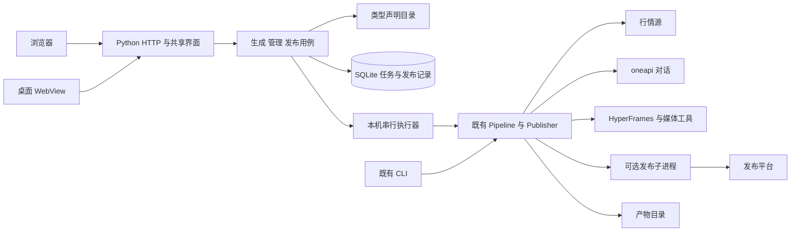

# 股票视频平台架构

架构设计（首版范围已确认） · WAN-207 · 仓库证据基线 `e9cddcc`。产品输入为 WAN-206 评论交付的 `PRD.md` 与 `ACCEPTANCE.md`。本文和五篇 ADR 描述目标设计，下面的接口名称供实现采用。现阶段已执行的是仓库只读核对和匿名 HTTP 冒烟。

## 系统边界

首版运行在单运营者的一台工作站上。Web 浏览器与桌面窗口连接同一个 Python 服务，类型目录、配置、任务、成片与发布报告共享。行情、oneapi 和发布平台是外部系统；渲染器与可选发布工具由服务主机执行。沿用 CLI 入口和现有定时守护流程，平台任务与旧 CLI 各用独立输出根。若共用发布账户，两条路径都使用相同的账户互斥，切换期间暂停同账号的旧守护发布。

| 模块 | 职责与边界 |
| --- | --- |
| 共享界面与 HTTP | Python 提供同源 Jinja2 页面和少量 JS，显示表单、进度、能力与结果。WebView 加载同源页面。HTTP 层验证请求、分页和映射错误。运行阶段、发布判断及凭据由后端掌握 |
| 应用用例与任务执行器 | 校验类型和模型、存入任务、调用现有 Pipeline，按阶段记录进度。发布从审核后的产物发起，按平台写入独立记录 |
| 类型与媒体 | 类型清单从 ADR-002 声明目录加载。核心保留行情、剧本、合规、TTS、工程、渲染、封面、字幕功能；用声明提供阵容、版式、骨架与默认规则 |
| 外部适配 | 对话统一经 oneapi。TTS 与封面 AI 首版沿用现有路径，后续迁移按 ADR-003 的能力证据决定。发布适配器复用 Publisher 的平台规格与进程守卫，并可注入替身 |
| 状态与文件 | SQLite 管任务、产物索引及发布记录。文件根保存内容和 sidecar，历史 CLI 补发继续读其 sidecar。服务 API 用产物 ID 读取文件 |
| 凭据 | oneapi 令牌由服务进程环境注入。平台登录态位于运营者账户下独立的原有工具配置目录。API 和 UI 只暴露预检状态，数据和证据归档排除凭据 |

仓库已有编排、进度、审查和落盘契约。生成阶段见 `stocktalk/pipeline.py:387-475`，结果和发布见 `stocktalk/pipeline.py:477-515`，历史补发见 `stocktalk/cli.py:653-716` 和 `stocktalk/cli.py:932-959`。平台用例以 `publish=False` 调用 Pipeline，再单独调 Publisher，Web 发布前先提供产物供审阅。传统 CLI 仍通过已有入口调用核心。

## 数据流与接口

1. `GET /api/types` 和 `GET /api/models` 提供启用的类型、模型。提交 `POST /api/tasks` 携带股票、类型、模型与选填生成参数。校验完成后返回 202 和任务 ID。请求以幂等键避免双击重复入队。
2. 执行器从 SQLite 领取任务，使用本次版本快照和隔离工作目录。状态查询 `GET /api/tasks/{id}` 返回当前阶段、进度、产物与错误。固定输入替身在行情、模型、媒体、发布等适配点注入，端到端测试至少检查真实可读取的 MP4 和产物索引。
3. `GET /api/tasks` 按类型、股票、日期与状态筛选。详情显示已审脚本、封面、画幅、报告及失败原因。下载以任务和产物 ID 读取，历史记录保留原类型 ID。
4. 用户确认平台后提交 `POST /api/tasks/{id}/publications`，记录平台、帐号引用、画幅、定时发表时间和 AI 声明。 `GET /api/tasks/{id}/publications` 返回逐平台状态，报告含任务 ID。补发显式选择失败平台；未知远端结果须先核对。发布预检使用同一适配器，返回依赖、登录态和需要人工操作的细项。
5. Web 和桌面消费相同的任务、类型与产物接口。浏览器轮询即可恢复刷新后的进度。前端和 CLI 通过同一套核心测试用例核对生成语义。审查页、模型输出与扩展模板按不受信内容校验和隔离展示。

## 实现顺序与验证

下表编号对应 WAN-206 的产品验收。每片可在列出的依赖已合并时单独落地，合并条件为该行的测试和走查。S1 与 S2 可能触及同一生成器文件，建议先合 S1 再移植 S2 的错误透传，二者可分别在基线上实现与验证，各自没有功能依赖。涉及多个切片的产品 AC 在最后一次联调归档完整证据。

| 切片 | 显式依赖与交付 | 对应 AC | 自动化验证 | 人工观察与留证 |
| --- | --- | --- | --- | --- |
| S1 类型契约 | 无。内置辩论/独白经过注册表，提示词、骨架、角色归一化、TTS 与版式消费同一份声明。示例验证命令和 CLI 共用注册表 | 01、10、12 | 旧配置与命令回归，错误 ID、重复 ID、缺数据、停用隔离、陌生角色 ID 在提示词、脚本、画面、音轨和字幕中的一致性 | 声明全文、D-0/1/5/8 验证日志、generated sidecar 与音轨清单 |
| S2 oneapi 对话 | 无。在既有 dialogue 工厂注册 oneapi，交付配置、模型清单、生成器错误透传及 Pipeline 重试分类。用替身独立验证，实网验收依赖 V1/V2 | 04、07、08、10、11、12 | 注入传输，断言地址、模型与鉴权来源；四类错误、缺密钥、跨域重定向；从 Pipeline 入口断言 POST 发出后超时仅发生一次对话请求，封锁替身之外的网络 | 原始请求/响应脱敏样本、模型清单和配置、无第二出口的日志 |
| S3 独立发布工具 | 无。可选 SAU 运行时、兼容桥、平台能力与回退对照 | 05、07、10 | 六平台 argv/cwd 与结果协议对照，缺依赖、登录态、定时、声明、多画幅、失败分类与回退 | 沙箱报告、两套配置的预检输出、依赖/体积和 patch 统计，实际回退记录 |
| S4 Web 生成与管理 | S1、S2。SQLite、产物索引、队列、浏览器提交/列表/详情 | 01、02、06、08、10、11 | 重复请求、崩溃恢复、版本快照、筛选、下载边界、模型拒绝、两次渲染输出隔离 | 服务启动与健康响应、生成与状态 JSON、筛选和产物截图 |
| S5 Web 发布与定向补发 | S3、S4。逐平台报告、预检、定时及失败补发，固定输入走通 Web | 01、02、05、06、07、10、12 | 发布替身捕获画幅和定时/声明参数，失败只补目标，提交后中断进入结果待确认 | 同任务 ID 的四份 JSON、四个阶段截图、四类错误 JSON/截图、回退证据 |
| S6 桌面共享与第三方复跑 | S5。桌面壳、两端能力标注、提供一次无密钥的验收脚本和证据索引 | 01、02、03、04、05、06、07、08、09、10、11、12 | 桌面连接同一 HTTP 地址、关闭窗口时服务及任务继续；D-0…D-8 与 AC-02/04 在洁净检出复跑 | 桌面启动日志、双端同任务和类型列表截图、能力标注、第三方逐 AC 对照表 |

各片保留 793 条基线用例并留存 `pytest -q` 输出。最终按 C1–C7 归档核心差异、无 UI 测试、vendor 统计、网络范围、密钥扫描、复跑证据与回归摘要。AC-05 的真实平台覆盖依照 PRD 先用沙箱证据，真实帐号外部服务行为留作盲区。

## 首版确认与实施验收

| 项 | 当前设计与待补证据 | 影响与负责人 |
| --- | --- | --- |
| V1 / V2 / O6 | 首版仅统一对话，TTS 与封面 AI 沿用现有路径。匿名模型清单返回 401 | WAN-208 可先实施不依赖网关的 S1，并用替身推进 S2。维护方后续提供脱敏授权清单、成功对话、认证方式、限时及媒体能力。AC-04/11 实网部分由 WAN-208 实测，媒体迁移根据能力另行决策 |
| V3 / V7 | Web 发起渲染、预检和发布，程序由共享本机 Python 服务执行。桌面首版查看同一任务的状态、成片与发布报告 | WAN-208 按 ADR-001 在 S4–S6 留存同一任务的双端证据，验收 AC-03/09 |
| V4 / V5 / V6 | 提供 PRD 字段完整的示例类型契约，管理按 §3.2 首版清单，外置工具按现有六平台参数和行为保全 | juzhong / WAN-205 负责人确认真实第三类的草稿（若用于扩展契约验收）、管理清单、发布保全口径。示例可用于既定 D-0…D-8，真实场景对照待确认 |

## 运行与退出

首版一套 Python 后端、一个 SQLite 文件、同一台主机的媒体与发布子进程，桌面窗口独立可选。固定新增基础设施月费设计为 0 美元，前提是使用现有工作站；oneapi 按量、磁盘备份与运营时间另计，网关费率待维护方提供，项目基础设施预算上限为 50 美元/月。运维主要是一次版本锁定、备份和运行时升级验证。退出时停服务，导出 SQLite/任务 JSON 与文件清单和媒体，另由所有者安全保管或撤销凭据。CLI 可继续消费既有 sidecar。
